# Letters — feature gallery

These are original screenshots of Letters running natively in an iPhone simulator, not edited mockups. **Letters is a portfolio prototype with separately tested encrypted-messaging/account foundations; it is not yet a usable private messenger.** All people, numbers, media, headlines and prices in these portfolio views are fictional. No real invitations, OTPs, passkeys, conversations or biometric data are published.

## Browse by feature

| Feature | Original screenshot | What the image demonstrates |
|---|---|---|
| Chats and Letters branding | [Open image](01-chats-preview.png) | Fictional local conversation list. |
| Alert All | [Open image](02-alert-all-rehearsal.png) | Local emergency-alert rehearsal; no notification is sent. |
| Personal Letterbox QR | [Open image](03-letterbox-qr-preview.png) | Harmless session-local invitation preview. |
| Orbital Home / world news | [Open image](04-orbital-home-news-preview.png) | Animated Earth/atom UI; labelled sample headline. |
| Indexes Markets | [Open image](06-market-indexes-preview.png) | Benchmark selection/index points; fictional sample. Embedded S&P 500 restricted by provider. |
| Chat clock | [Open image](07-chat-clock-preview.png) | Top-right cyan clock opens timer controls. The surrounding chat contains fictional local messages. |
| Self-destruct timer | [Open image](08-message-timer-preview.png) | All eight requested timer choices. Expiry currently removes only local sample payloads; it does not enforce remote deletion. |
| Self-Destruct Now | [Open image](09-self-destruct-now-preview.png) | Native confirmation before clearing the current local sample chat. No claim of remote deletion or secure erasure. |
| Voice notes | [Open image](10-voice-note-preview.png) | Local record/review/play interface. This fixture is synthetic silence, not a real person’s recording; no message is sent by the screenshot. |
| Photo messages | [Open image](11-photo-message-preview.png) | Locally generated orbital image prepared for a sample chat. No upload or delivery receipt. |
| GIF messages | [Open image](12-gif-message-preview.png) | Locally generated orbital animation. Actual GIF decoding runs on-device; a still image does not demonstrate motion. |
| Video messages | [Open image](13-video-message-preview.png) | On-device generated silent orbital clip prepared for local review. Native playback and imported codecs still require interactive device QA. |
| Files | [Open image](14-file-message-preview.png) | A harmless fictional document selected for local attachment. Documents are not executed and no network send is shown. |
| Invitation + phone registration | [Open image](15-invitation-phone-registration-preview.png) | Invitation/country-code/phone/OTP/passkey sequence. SMS is disabled; the displayed number is fictional and no account is created. |
| Passkey and biometrics | [Open image](16-passkey-access-preview.png) | Passkey access design with disabled account actions and a separate local biometric capability demonstration. No live sign-in or biometric enrollment is shown. |
| Voice calling | [Open image](17-voice-call-preparation-preview.png) | Existing local call-preparation interface, not an encrypted live call. |
| Orbit stickers | [Open image](18-orbit-stickers-preview.png) | Local sticker pack and import control. No persistent encrypted sticker delivery is shown. |
| Global stocks headlines | [Open image](19-global-stocks-news-preview.png) | Orbital Home/news runner in the global-stocks category, using a labelled fictional sample headline. Normal RSS retrieval is tested separately. |
| Oil headlines | [Open image](20-oil-news-preview.png) | Orbital Home/news runner in the oil category with a labelled fictional headline; not a market quote. |
| Crypto headlines | [Open image](21-crypto-news-preview.png) | Orbital Home/news runner in the crypto category with a labelled fictional headline; not a current news event. |
| Oil Markets | [Open image](22-oil-markets-preview.png) | WTI/Brent indicative-CFD selection, USD/barrel. Explicit fictional sample prices, not physical spot or futures settlement quotes. |
| Bitcoin Markets | [Open image](23-bitcoin-markets-preview.png) | Venue-specific Coinbase BTC/USD selection with explicit fictional sample prices. |
| Stocks Markets | [Open image](24-stocks-markets-preview.png) | Current four-section Markets layout and global share-listing picker. Explicit fictional sample prices; provider availability/delays are separate. |
| Encrypted development chat | [Open image](25-encrypted-development-chat.png) | Actual Debug configuration screen, disconnected and empty. Real SDK text/media tests passed separately; this image is not proof of a live native conversation. |

The [first three-section Markets capture](05-markets-preview.png) is retained as historical design progress. The current Markets screen includes Stocks, Indexes, Oil and Bitcoin and opens from the Home menu.

## New feature captures — 22 October 2026

Screenshots **07–11 and 13–24** came from source `86fa1244f3a55bfc99cc91f755fd52eb018f2830`, [successful run 39729529591](https://github.com/abhi-sarnath-git/Letters-Source-Code/actions/runs/39729529591). Downloaded artifact SHA-256: `88303eada2e17c458c718e85e061c5d0cc2a82af430e4039a60bacbbfb59e2ea`. Each original image was inspected after checksum verification. The oversized first GIF capture was rejected and is not published; screenshot 12 uses the corrected capture documented below.

Screenshot **12** came from corrected source `50984f8210d640091425d09553987205c9856163`, [successful run 39730967900](https://github.com/abhi-sarnath-git/Letters-Source-Code/actions/runs/39730967900). Artifact SHA-256: `a478d43acc762927a4ea662b9eaa290d5e34789d07757df8688c11e0af171b1a`. The downloaded artifact was checksum-verified and the corrected GIF layout visually inspected. The full account, encryption, core and native build checks also passed again.

Original images 01–06 keep the provenance recorded in [README.md](README.md). See [image checksums](SHA256SUMS.txt). No PNG was retouched, composited or rescaled for publication. The small display sizes below are Markdown rendering only.

Chat clock

Top-right cyan clock opens timer controls. The surrounding chat contains fictional local messages.

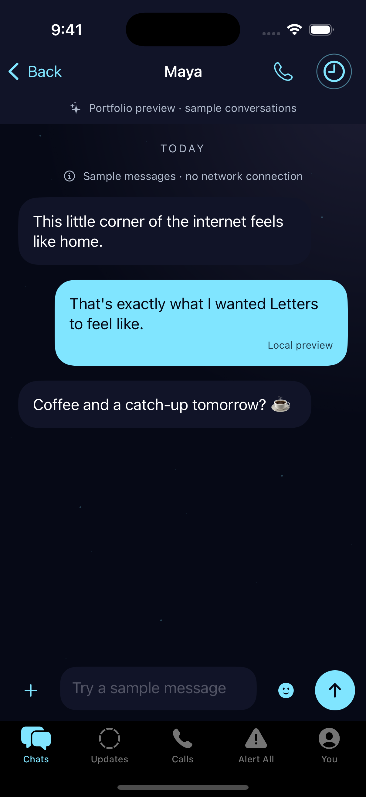

Self-destruct timer

All eight requested timer choices. Expiry currently removes only local sample payloads; it does not enforce remote deletion.

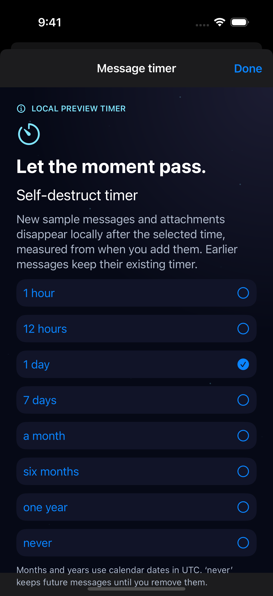

Self-Destruct Now

Native confirmation before clearing the current local sample chat. No claim of remote deletion or secure erasure.

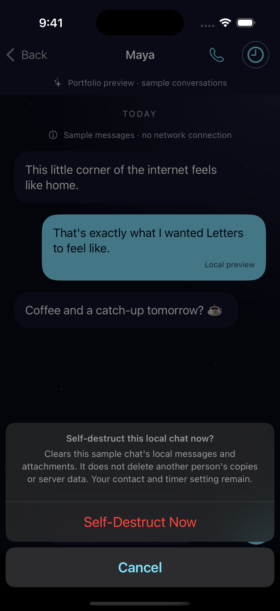

Voice notes

Local record/review/play interface. This fixture is synthetic silence, not a real person’s recording; no message is sent by the screenshot.

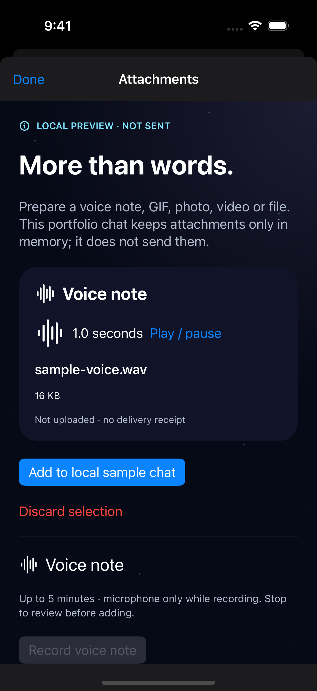

Photo messages

Locally generated orbital image prepared for a sample chat. No upload or delivery receipt.

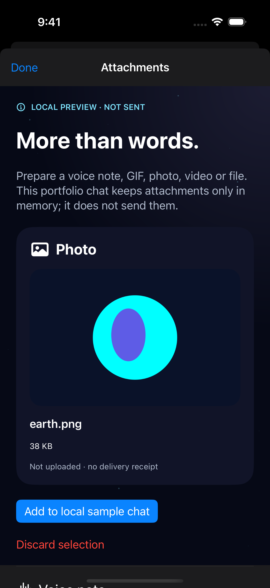

GIF messages

Locally generated orbital animation. Actual GIF decoding runs on-device; a still image does not demonstrate motion.

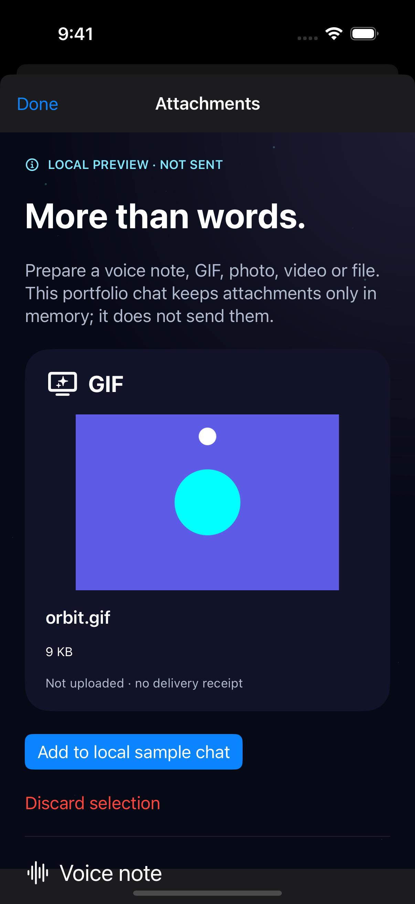

Video messages

On-device generated silent orbital clip prepared for local review. Native playback and imported codecs still require interactive device QA.

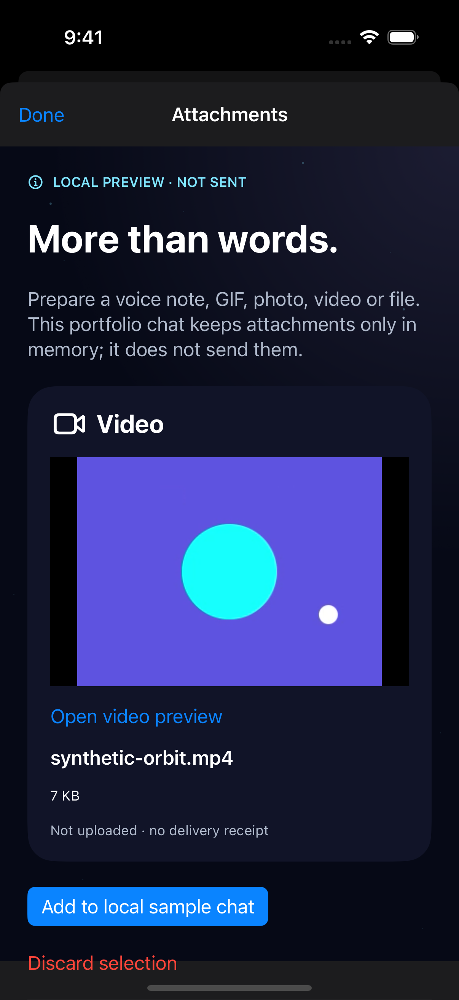

Files

A harmless fictional document selected for local attachment. Documents are not executed and no network send is shown.

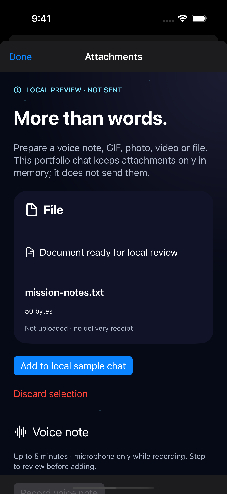

Invitation + phone registration

Invitation/country-code/phone/OTP/passkey sequence. SMS is disabled; the displayed number is fictional and no account is created.

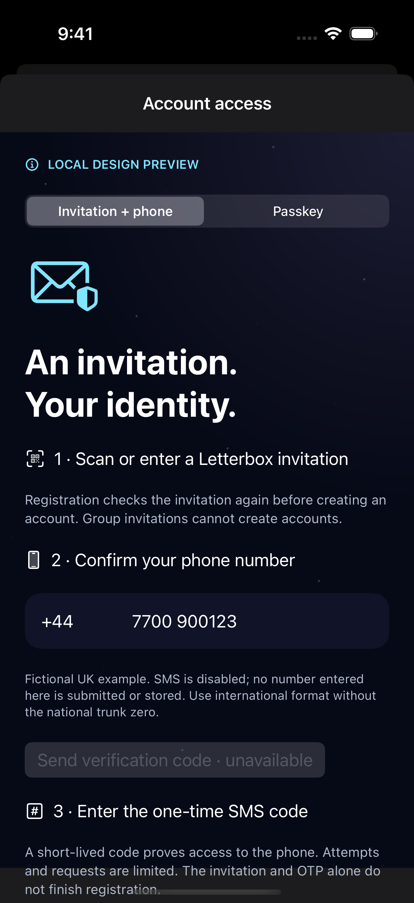

Passkey and biometrics

Passkey access design with disabled account actions and a separate local biometric capability demonstration. No live sign-in or biometric enrollment is shown.

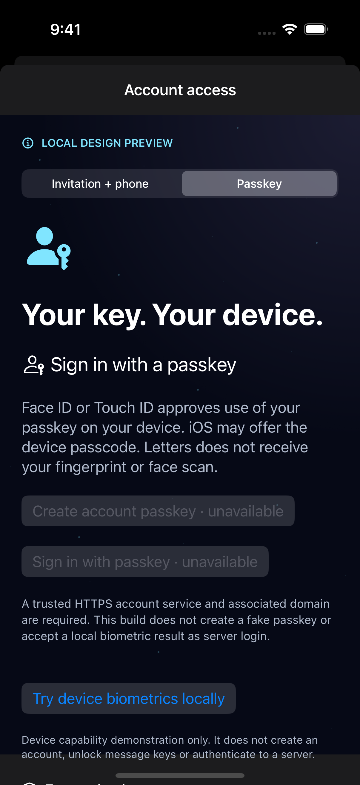

Voice calling

Existing local call-preparation interface, not an encrypted live call.

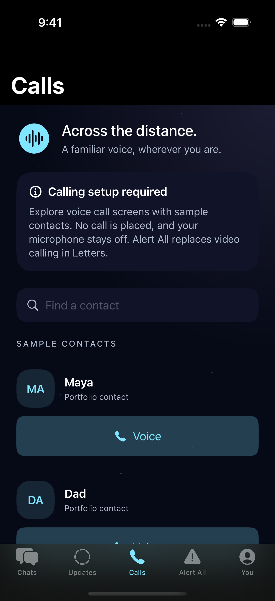

Orbit stickers

Local sticker pack and import control. No persistent encrypted sticker delivery is shown.

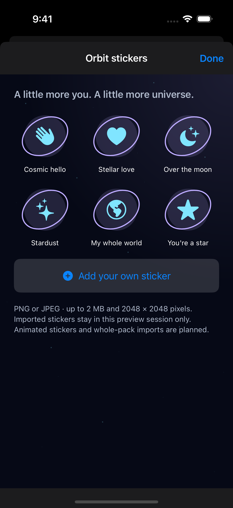

Global stocks headlines

Orbital Home/news runner in the global-stocks category, using a labelled fictional sample headline. Normal RSS retrieval is tested separately.

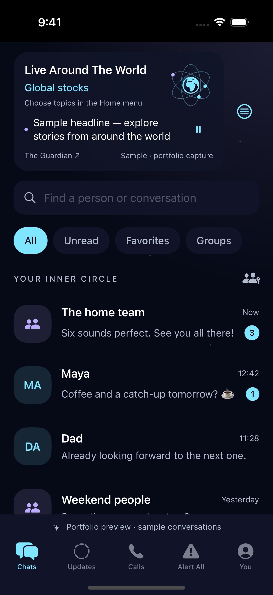

Oil headlines

Orbital Home/news runner in the oil category with a labelled fictional headline; not a market quote.

Crypto headlines

Orbital Home/news runner in the crypto category with a labelled fictional headline; not a current news event.

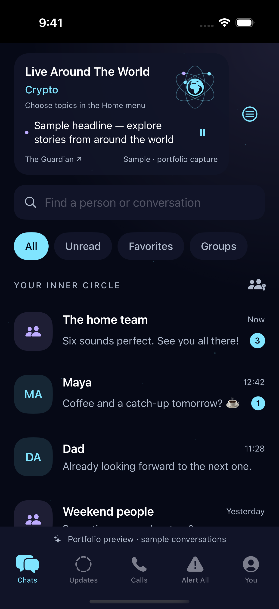

Oil Markets

WTI/Brent indicative-CFD selection, USD/barrel. Explicit fictional sample prices, not physical spot or futures settlement quotes.

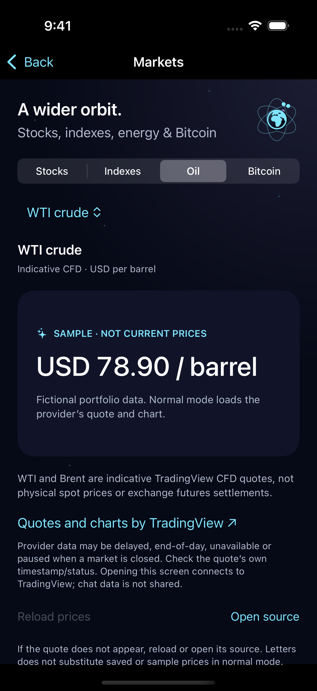

Bitcoin Markets

Venue-specific Coinbase BTC/USD selection with explicit fictional sample prices.

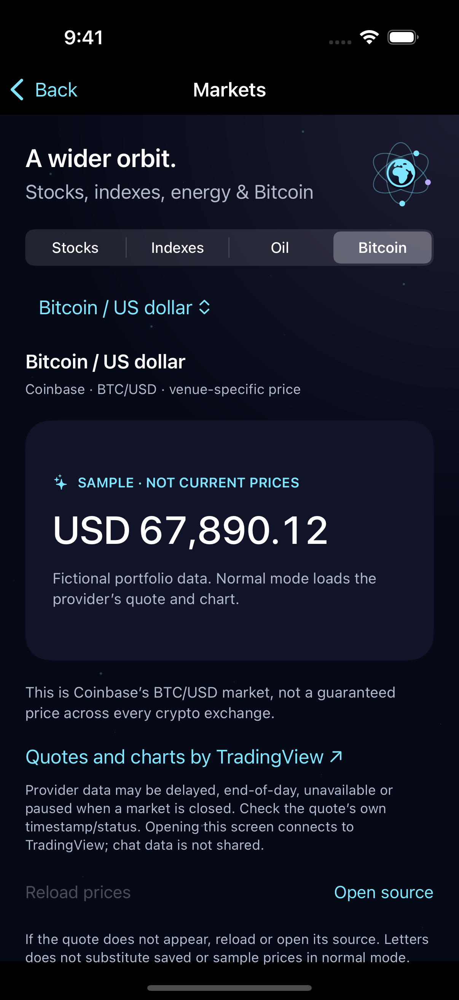

Stocks Markets

Current four-section Markets layout and global share-listing picker. Explicit fictional sample prices; provider availability/delays are separate.

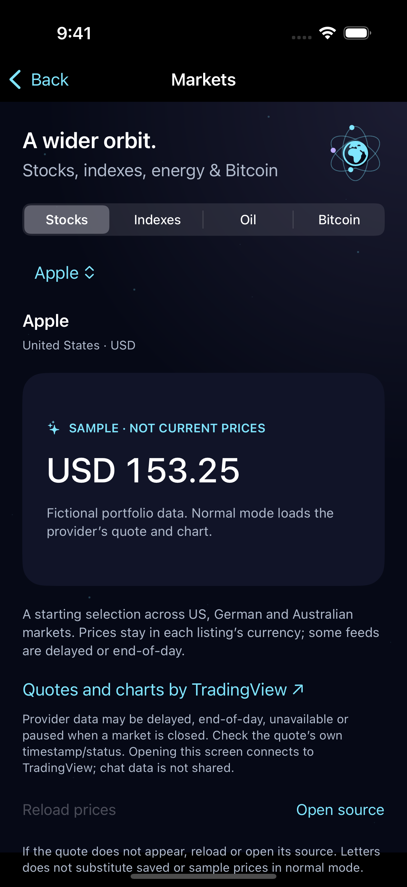

## What the screenshots cannot prove

A still image cannot establish encryption, animation, microphone behavior, message delivery, biometric authentication or remote deletion. Hosted tests separately verified independent-recipient decryption and server-side ciphertext for five media kinds, and real WebAuthn signature/origin/UV/replay/counter checks using a synthetic authenticator. They did not involve real SMS, biometric enrollment or two physical iPhones.

Native chats/media/timers remain local previews. SMS and live passkey account actions are disabled. Calls and Alert All do not send anything. Remote expiry, media cleanup, account/chat integration and physical-device/accessibility/recovery review remain required. Read [account/media/timer implementation limits](../../Docs/ACCOUNT_AND_MEDIA.md), [encryption evidence](../../Docs/ENCRYPTED_MESSAGING.md), [Markets limitations](../../Docs/MARKETS.md) and the [completion checklist](../../Docs/CHECKLIST.md).

## Native development integration — 22 October 2026

25 — encrypted development chat configuration

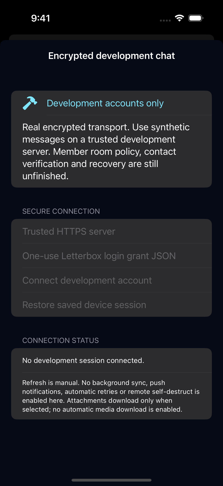

Original native capture of the Debug-only account/session connection screen. No server URL, login grant, real account or private message was entered. Controls depend on an operator-configured synthetic server. Manual room/contact IDs remain a development step; end-user invitation enrollment and server room policy are unfinished. This screenshot demonstrates the actual compiled native configuration interface, not a completed messenger or delivery between phones.

Source `e79072dccd6ffb47ab9b177423b81f24e812e675`; successful [workflow 39761150753](https://github.com/abhi-sarnath-git/Letters-Source-Code/actions/runs/39761150753), job 119765991763. Artifact 12419127205 SHA-256 `966afe0e68d0c718cc611a76dd233730c83fbeacb6dcaabbd1984d6cb84c2b04` was verified before extracting and inspecting this unmodified PNG. Individual image SHA-256: `a17c2a81a990394bc530cc1a6c366117649d74d520ec0d29863af732b1a7c407`.

