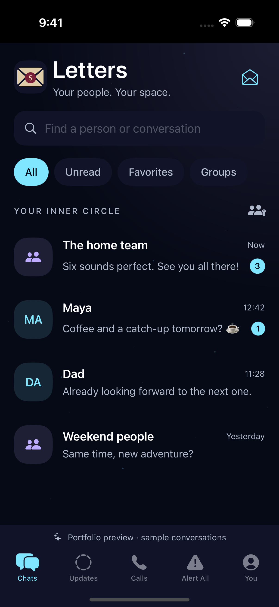
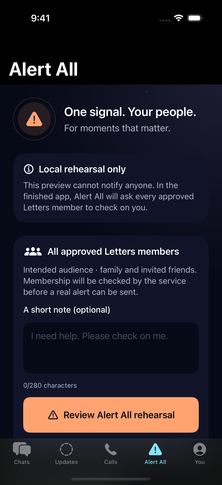
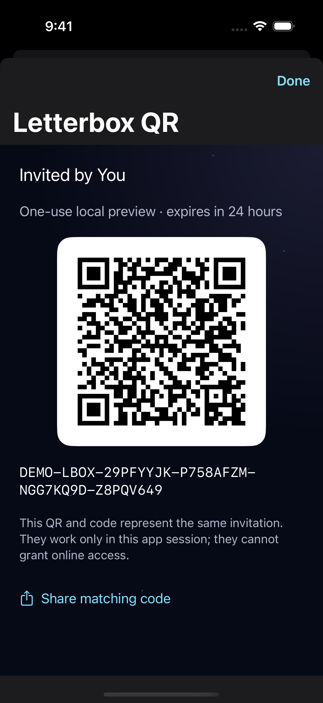
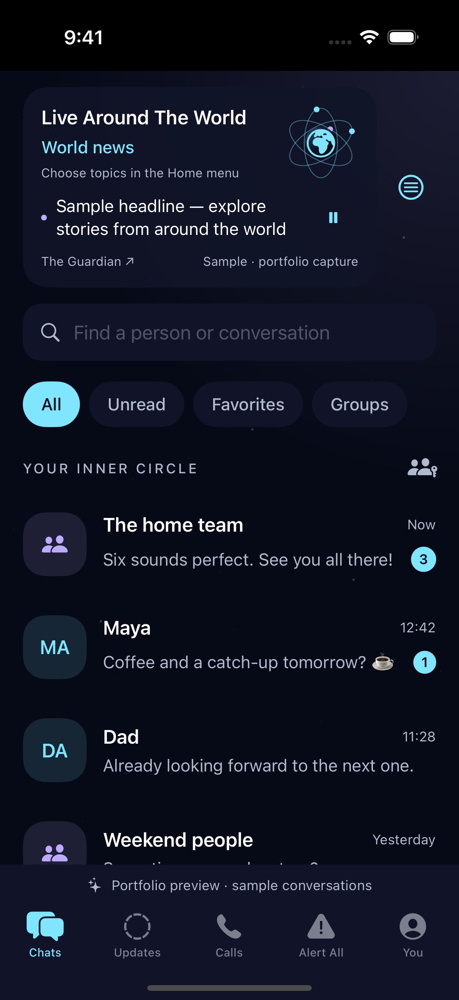
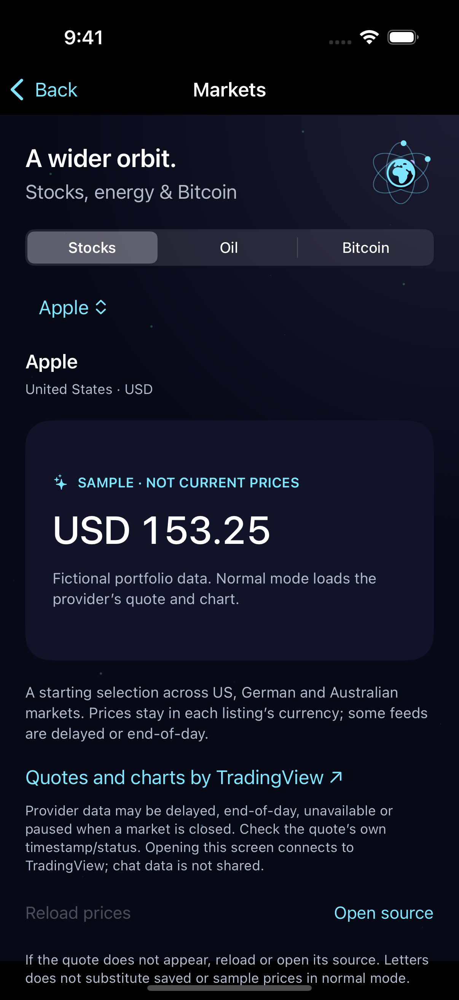
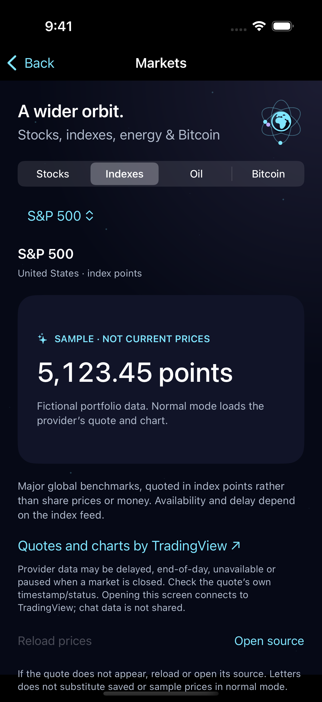

# Prototype Screenshots

Original screenshots of Letters running in an iPhone 16 Pro simulator, captured on 21 October 2026 with Xcode 16.4 / iOS 18.5. These are actual native SwiftUI screens, not design mockups. All conversations and profiles are fictional.

**Current stage: portfolio prototype with live public news; messaging remains local.** These screenshots demonstrate completed local interfaces and behavior, not working encrypted communication. Live encrypted messages in these interfaces, voice calls, emergency notifications and cross-device invitation redemption remain unavailable. A separate Matrix encryption development package now exists; see [its implementation and test limits](../../Docs/ENCRYPTED_MESSAGING.md). These images are not evidence of encrypted delivery. Home now fetches public news separately; the new Home screenshot deliberately uses an identified sample headline.

## Chats — local interface

Letters branding, beige envelope with S seal, space-age theme, fictional conversations, search and conversation filters. Message composition and sticker use stay in memory on this device.

## Alert All — local rehearsal

Emergency-alert preparation for all approved Letters members, optional note, explicit confirmation, duplicate-active protection and ending a rehearsal. It does not notify anyone, contact emergency services or fabricate acknowledgements.

## Letterbox QR — local invitation preview

A member's one-use invitation QR and matching manual code. Every sample member can generate their own invitations and have a different contact list. Groups require separate admission. Preview codes are session-local and grant no online access; the QR shown here is harmless fictional test data.

## Orbital Home — news runner and task-based menu

An Earth/atom replaces the Home name heading, with orbiting electrons at runtime. “Live Around The World” offers World, Global Stocks, Oil and Crypto headline categories through the Home menu. Actions are grouped as Chats & People, Around the World, Connect, Safety and You; chat filters and tabs stay available as shortcuts. Headline/filter changes use short fades and respect Reduce Motion. An open article keeps its original headline and link while feeds refresh.

The image uses a **fictional, labelled sample headline**, not an actual news event or a quote from The Guardian. Normal mode reads public Guardian RSS, with source attribution, five-minute foreground refresh and honest offline/cache states. This screenshot shows the menu button, not the open menu; a still image cannot demonstrate orbital motion or transitions. Physical-device usability and accessibility QA remain outstanding.

Capture source: `28731c4bba2aede95609ea84e528bd337a566a28`, [Home refinement run](https://github.com/abhi-sarnath-git/Letters-Source-Code/actions/runs/39556128782). The original three screenshots below retain their earlier source provenance.

## Markets — opened from Home drop-down

Stocks, Oil and Bitcoin have a dedicated screen reached from the Home menu, with Back navigation and no new bottom tab. Sections and an instrument picker separate global share listings, WTI/Brent indicative CFDs and Coinbase BTC/USD. Normal mode uses attributed provider widgets, with currency/feed/venue labels and reload/source actions.

This original native capture shows **fictional sample prices**, prominently labelled “SAMPLE · NOT CURRENT PRICES.” It does not show an actual TradingView quote/chart or certify current prices. Source `1d637be383d532576b36957df45e909803c207c8`, [capture run 39682680676](https://github.com/abhi-sarnath-git/Letters-Source-Code/actions/runs/39682680676), original screenshot artifact SHA-256 `70a3e9a2bc816877a453c7318098cb1cc829f1c2737a72debfbcee7cc6b02e42`. Image inspected after checksum verification. See [MARKETS.md](../../Docs/MARKETS.md) for supported instruments and outstanding provider/device QA.

## Markets — Indexes added

The Home-menu Markets screen now has **Stocks, Indexes, Oil and Bitcoin**. Indexes offers S&P 500, Nasdaq 100, Dow Jones, DAX and Japan 225, with values identified as index points.

This original native screenshot uses **fictional sample values**, labelled “SAMPLE · NOT CURRENT PRICES.” The normal-mode S&P 500 check revealed a provider restriction: its embedded widget directs users to TradingView rather than displaying a quote. Other index feeds remain unverified. This image demonstrates the completed interface, not working embedded index prices.

Capture source: `6701fd9a0864d92b700d20f333f4e82e121e4c10`, [successful build and capture run](https://github.com/abhi-sarnath-git/Letters-Source-Code/actions/runs/39687281594). Original screenshot artifact SHA-256: `d169fcbda77c669b796a8d119c8bf676d0b8acfc4578ddd42a5de2e2ea5ea277`. Image inspected after checksum verification, without retouching.

## Verification and provenance

- Source: [`fe2ee0c5b552b0d2f1b3bf4a83f0f45d38b467e9`](https://github.com/abhi-sarnath-git/Letters-Source-Code/commit/fe2ee0c5b552b0d2f1b3bf4a83f0f45d38b467e9).
- [Successful capture run](https://github.com/abhi-sarnath-git/Letters-Source-Code/actions/runs/39549406715): 10 Swift tests, 10 server admission tests, native compilation and simulator launches passed. The Letterbox QR was decoded directly from the screenshot by Apple's Vision framework.
- Original artifact SHA-256: `60d5ab815d7e42fc835507b8c12bd31e936a57ecff960aa709d393e4dd80f81e`.
- Images are the original PNG captures, without retouching or compositing. Physical-device camera scanning, VoiceOver, large-text and interactive end-to-end UI QA are not certified by these captures.

## Portfolio updates

For each completed feature, capture its actual native screen after relevant build/tests pass, inspect the image, then add it here with a concise caption, source commit and verification evidence. Label local previews and live functionality separately. Use fictional accounts and data only; never publish real invitation/session tokens, keys, private chats or infrastructure/account screenshots.

The full completion checklist remains in [Docs/CHECKLIST.md](../../Docs/CHECKLIST.md). Deployment and app-distribution work is deferred at the owner's request while app development continues.
